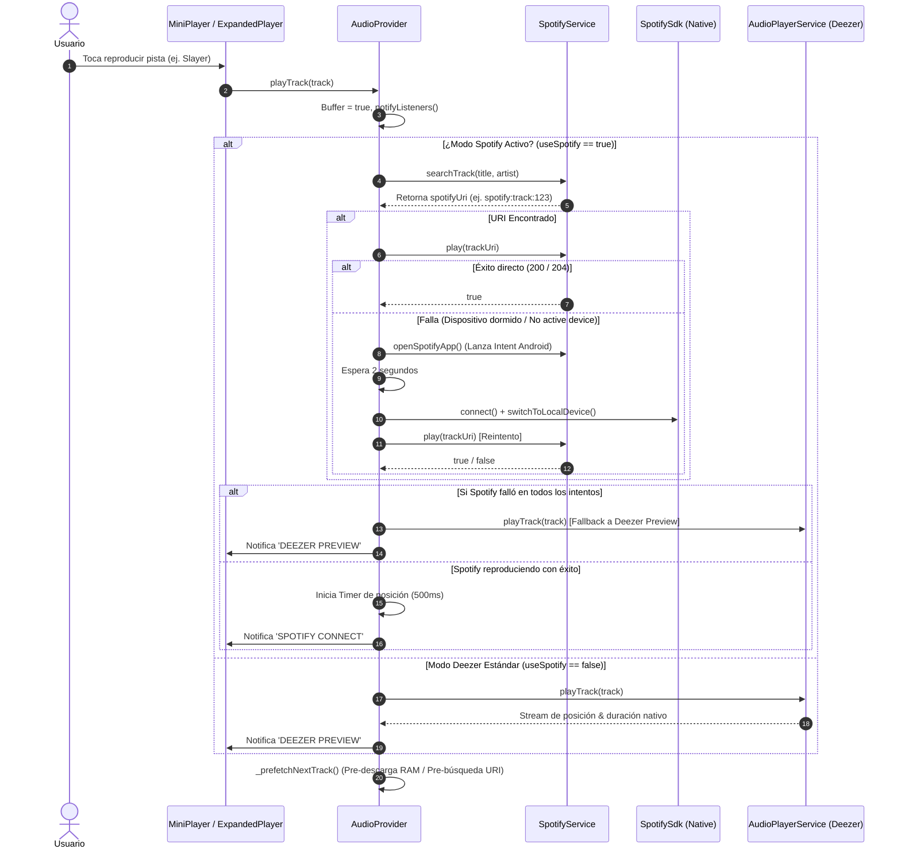

# 🎧 Arquitectura Técnica: Conexión Spotify & Mini Player en Tsuki Tunes Mobile

Este documento detalla en profundidad el funcionamiento interno, el flujo de datos, los motivos técnicos de irregularidad en la conexión con Spotify y el funcionamiento del Mini Player en **Tsuki Tunes Mobile**.

---

## 📑 Tabla de Contenidos
1. [Visión General del Sistema de Audio Híbrido](#1-visión-general-del-sistema-de-audio-híbrido)
2. [Conexión con Spotify: ¿Cómo funciona?](#2-conexión-con-spotify-cómo-funciona)
   - 2.1 Flujo de Autenticación (OAuth 2.0 PKCE)
   - 2.2 Estrategia Dual: Web API (Connect) vs Native SDK (App Remote)
   - 2.3 Resolución Predictiva de URIs
3. [¿Por qué la conexión con Spotify se siente irregular?](#3-por-qué-la-conexión-con-spotify-se-siente-irregular)
   - 3.1 El problema del "Active Device" (Dispositivo Dormido)
   - 3.2 Optimización de Batería de Android (OEM Aggressive Doze)
   - 3.3 Requisito Estricto de Cuenta Spotify Premium
   - 3.4 Discrepancias de Metadatos (Deezer Catalog vs Spotify Catalog)
   - 3.5 Caída silenciosa a Preview de Deezer (Fallback)
4. [El Mini Player: Arquitectura y Funcionamiento](#4-el-mini-player-arquitectura-y-funcionamiento)
   - 4.1 Ubicación en el Árbol de Widgets
   - 4.2 Estados y Notificaciones (AudioProvider + NavigationEvents)
   - 4.3 Gestos y Micro-interacciones
   - 4.4 Barra de Progreso y Sincronización en Tiempo Real
5. [Diagrama de Flujo del Motor de Reproducción](#5-diagrama-de-flujo-del-motor-de-reproducción)
6. [Plan de Mejoras y Recomendaciones para Estabilidad 100%](#6-plan-de-mejoras-y-recomendaciones-para-estabilidad-100)

---

## 1. Visión General del Sistema de Audio Híbrido

Tsuki Tunes utiliza una **arquitectura de doble motor de reproducción** administrada por el [`AudioProvider`](lib/presentation/state/audio_provider.dart):

```
                       ┌────────────────────────────────────────┐
                       │             AudioProvider              │
                       │    (Controlador Central de Estado)     │
                       └───────────────────┬────────────────────┘
                                           │
                    ¿Está conectado a Spotify y es Premium?
                                    /             \
                                  SÍ               NO
                                 /                   \
        ┌───────────────────────────┐     ┌───────────────────────────┐
        │       Motor Spotify       │     │     Motor Deezer Local    │
        │ - SpotifyService (Web API)│     │ - AudioPlayerService      │
        │ - SpotifyNative (App Rem) │     │ - just_audio (ExoPlayer)  │
        │ - Audio precaching URI    │     │ - Pre-cache RAM 5s (Gap)  │
        └───────────────────────────┘     └───────────────────────────┘
```

- **Motor Deezer (Local / `just_audio`)**: Reproduce el archivo MP3 (pre-escucha de 30s) usando el reproductor nativo del sistema. Es 100% inmediato y ahora cuenta con pre-descarga en RAM (*Zero-Latency Gapless*).
- **Motor Spotify (`SpotifyService` + `spotify_sdk`)**: Si el usuario vinculó su cuenta Premium, la app busca el tema en el catálogo de Spotify e instruye al servicio de Spotify para reproducir la canción completa en alta fidelidad.

---

## 2. Conexión con Spotify: ¿Cómo funciona?

### 2.1 Flujo de Autenticación (OAuth 2.0 PKCE)
Ubicación: [`lib/data/datasources/spotify_service.dart`](lib/data/datasources/spotify_service.dart)

1. **Generación de Verificador y Challenge**:
   - Se genera un `code_verifier` criptográfico aleatorio y su respectivo `code_challenge` mediante hashing SHA-256 (`S256`).
2. **Navegador Seguro**:
   - `FlutterWebAuth2.authenticate()` abre la pantalla de inicio de sesión de Spotify con el esquema `com.tsuki.tsukitunesmobile://spotify-callback`.
   - Se solicitan los siguientes scopes clave:
     - `streaming`: Para control de reproducción en tiempo real.
     - `user-read-playback-state` y `user-modify-playback-state`: Para consultar dispositivos activos y enviar órdenes de Play/Pause/Seek.
     - `app-remote-control`: Para comunicarse por IPC con la app de Spotify en Android.
3. **Almacenamiento Cifrado**:
   - Los tokens (`access_token`, `refresh_token`, fecha de expiración y perfil) se almacenan de forma segura en `FlutterSecureStorage` (usando `EncryptedSharedPreferences` en Android).
4. **Auto-Refresco con Bloqueo de Concurrencia**:
   - Los tokens de acceso expiran cada 60 minutos. El método `_ensureValidToken()` utiliza un `Completer<void>` (`_refreshLock`) para asegurar que si 3 peticiones ocurren al mismo tiempo cuando el token venció, solo se haga **una sola solicitud** de refresco a `https://accounts.spotify.com/api/token`.

---

### 2.2 Estrategia Dual: Web API (Connect) vs Native SDK (App Remote)
Para controlar Spotify en Android, la app utiliza dos herramientas combinadas:

1. **Spotify Web API (Spotify Connect)**:
   - Envía peticiones HTTP REST (`PUT https://api.spotify.com/v1/me/player/play`).
   - Ventaja: Es universal, permite buscar canciones por texto (`track:Title artist:Artist`) y enviar arrays de URIs.
   - Desventaja: **Requiere obligatoriamente un dispositivo activo** registrado en los servidores de Spotify.
2. **Spotify Native SDK (`spotify_sdk`)**:
   - Se conecta mediante un servicio Android AIDL (`connectToSpotifyRemote`) a la aplicación de Spotify instalada en el mismo teléfono.
   - Ventaja: Permite escuchar el estado del reproductor y cambiar al dispositivo local (`switchToLocalDevice()`).
   - Desventaja: Si la app de Spotify está cerrada por el sistema operativo, la conexión local falla con `CouldNotFindSpotifyApp`.

---

### 2.3 Resolución Predictiva de URIs
Ubicación: [`AudioProvider._prefetchNextTrack()`](lib/presentation/state/audio_provider.dart)

Para eliminar la espera cuando pasa a la siguiente canción:
- Mientras la pista actual está sonando, el sistema toma la siguiente pista de la cola y consulta en segundo plano a la API de Spotify `track:NextTitle artist:NextArtist`.
- Almacena el URI (`spotify:track:XXXXX`) en memoria.
- Al terminar la canción, la reproducción inicia con latencia de red cero para la búsqueda.

---

## 3. ¿Por qué la conexión con Spotify se siente irregular?

Muchos usuarios reportan que Spotify a veces reproduce bien, otras veces demora 3 segundos, otras veces abre la app oficial de Spotify de golpe, o cae al preview de Deezer. Esto se debe a 5 factores técnicos concretos:

### 3.1 El problema del "Active Device" (Dispositivo Dormido)
Spotify Connect **no puede reproducir audio en la nada**. La API REST de Spotify le dice a sus servidores: *"Reproduce este track en el dispositivo X"*.
- Cuando consultas `GET /me/player/devices`, si no has usado Spotify en los últimos 15-30 minutos, la lista de dispositivos suele venir **vacía (`[]`)** o con todos los dispositivos en `is_active: false`.
- **Qué hace Tsuki Tunes para rescatarlo**:
  1. Detecta que no hay dispositivo activo.
  2. Lanza un Intent de Android (`openSpotifyApp()`) para forzar a Spotify a despertarse en segundo plano.
  3. Espera 2 segundos a que el daemon de Spotify se registre en la nube.
  4. Intenta reconectar el Native Player y transferir la reproducción (`_transferPlayback`).
  5. Reintenta la orden de Play.
- **Por qué se siente irregular**: Esos 2 segundos de espera y el "despertar" de la app externa crean un retraso perceptible, y si el teléfono tiene poca RAM, el daemon tarda más de 2 segundos en responder.

---

### 3.2 Optimización de Batería de Android (OEM Aggressive Doze)
En teléfonos como **Xiaomi (MIUI/HyperOS)**, **Huawei/Honor (MagicOS/EMUI)** o **Samsung (OneUI)**:
- El sistema operativo "mata" agresivamente los procesos en segundo plano que no tienen un servicio en primer plano constante.
- La app de Spotify suele ser cerrada por el sistema a los pocos minutos de estar en pausa.
- Cuando Tsuki Tunes intenta conectarse al servicio AIDL remoto de Spotify, Android bloquea la conexión o devuelve un timeout.

---

### 3.3 Requisito Estricto de Cuenta Spotify Premium
- Spotify prohíbe explícitamente el control de reproducción arbitrario por API (reproducir una canción específica bajo demanda) para cuentas **Free**.
- Las cuentas Free están restringidas a reproducción aleatoria (*Shuffle Play*).
- Si la cuenta no tiene Premium activo, Spotify responde con código HTTP `403 FORBIDDEN` o `PREMIUM_REQUIRED`.
- Tsuki Tunes verifica `_isPremium = profile['product'] == 'premium'`, pero si la suscripción venció o la respuesta de perfil falló, el comportamiento se vuelve errático.

---

### 3.4 Discrepancias de Metadatos (Deezer Catalog vs Spotify Catalog)
Tsuki Tunes utiliza Deezer como catálogo visual y de búsqueda. Al momento de reproducir en Spotify, la app busca:
```
q = track:"South Of Heaven" artist:"Slayer"
```
- Si la canción en Deezer se llama `South Of Heaven (Live at Wacken 2014)` o `Raining Blood - 1986 Remaster`, y en Spotify está nombrada de forma distinta:
  - La búsqueda exacta falla.
  - La búsqueda parcial intenta buscar coincidencias de artista.
  - Si aún así no encuentra coincidencias fiables, **no puede obtener el URI de Spotify**.

---

### 3.5 Caída silenciosa a Preview de Deezer (Fallback)
Cuando Spotify falla (ya sea porque no hubo dispositivo activo tras el reintento, el track no se encontró en Spotify, o hubo un error de red):
```dart
if (!played) {
  debugPrint('Spotify: all play attempts failed, falling back to preview');
  _lastSpotifyError = 'spotify_open_app';
  await _service.playTrack(track); // <-- Fallback a Deezer
}
```
Para que el usuario **nunca se quede con la app congelada o en silencio total**, Tsuki Tunes activa automáticamente el preview de Deezer.
- El usuario nota que la música suena, pero ve que solo dura 30 segundos o nota que abajo dice `DEEZER PREVIEW` en lugar de `SPOTIFY CONNECT`.

---

## 4. El Mini Player: Arquitectura y Funcionamiento

Ubicación del código: [`lib/presentation/widgets/mini_player.dart`](lib/presentation/widgets/mini_player.dart)

El **Mini Player** es la barra flotante inferior que acompaña al usuario por toda la navegación (Home, Búsqueda, Biblioteca, Artista, Álbum).

```
┌─────────────────────────────────────────────────────────────┐
│  [Progreso 2.5px] ═══════════════════════════════ (Accent)  │
├─────────┬───────────────────────────────────┬─────────┬─────┤
│ Carátula│ Título de la Pista                │ OniMask │Play/│
│  44x44  │ Nombre del Artista                │ (List.) │Pause│
└─────────┴───────────────────────────────────┴─────────┴─────┘
```

### 4.1 Ubicación en el Árbol de Widgets
Se encuentra en [`lib/screens/main_navigation_screen.dart`](lib/screens/main_navigation_screen.dart), anclado en un `Positioned(bottom: 0)` sobre la barra de navegación Cyberpunk.

```dart
ValueListenableBuilder<bool>(
  valueListenable: NavigationEvents.isPlayerExpanded,
  builder: (context, isExpanded, _) {
    final shouldHide = isKeyboardOpen || isExpanded;
    return AnimatedSlide(
      offset: shouldHide ? const Offset(0, 1.2) : Offset.zero,
      child: Column(
        children: [
          AnimatedCrossFade(
            crossFadeState: hasTrack ? CrossFadeState.showFirst : CrossFadeState.showSecond,
            firstChild: const MiniPlayer(),
            secondChild: const SizedBox.shrink(),
          ),
          _buildCyberBottomNav(),
        ],
      ),
    );
  },
)
```

- **Ocultamiento inteligente**: Se desliza hacia abajo cuando se abre el teclado o cuando el reproductor expandido está abierto (`NavigationEvents.isPlayerExpanded = true`).
- **Desvanecimiento elegante**: Cuando no hay canción cargada, se contrae con `AnimatedCrossFade` en 300ms sin causar saltos bruscos en el layout.

---

### 4.2 Estados y Notificaciones (AudioProvider)
El Mini Player no guarda estado musical propio; es un consumidor puro del [`AudioProvider`]:
- Escucha `audio.currentTrack`, `audio.isPlaying`, `audio.isBuffering`, `audio.position` y `audio.duration`.
- Cuando el audio es de Spotify, la posición avanza mediante un `Timer.periodic(500ms)` sincronizado; cuando es de Deezer, avanza mediante el stream nativo de `just_audio`.

---

### 4.3 Gestos y Micro-interacciones
El Mini Player incluye soporte para gestos táctiles fluidos:

1. **Tap simple**:
   - Ejecuta `_openExpandedPlayer(context)` para abrir el reproductor completo con transición de deslizamiento vertical ascendente en 320ms (`Curves.easeOutCubic`).
2. **Deslizamiento hacia arriba (Swipe Up)**:
   - Si detecta un arrastre vertical con velocidad `velocity < -300`, abre de inmediato el reproductor expandido.
3. **Deslizamiento horizontal (Swipe Left / Right para cambiar de canción)**:
   - `_onHorizontalDragUpdate`: Mueve físicamente el contenido de la barra horizontalmente con resistencia (`_swipeDx * 0.3`) y atenúa el texto proporcionalmente (`ColorFilter`).
   - `_onHorizontalDragEnd`: Si el desplazamiento supera los 60px o la velocidad supera los 400px/s:
     - Swipe hacia la derecha ➡️: `audio.previous()`
     - Swipe hacia la izquierda ⬅️: `audio.next()`
   - Al soltar, una animación con resorte (`_resetController` + `Curves.easeOutCubic`) devuelve el Mini Player suavemente a su posición central.
4. **Acciones directas**:
   - **Play/Pause**: Alterna entre pausar y reproducir con un spinner de carga si la pista está buffereando.
   - **Oni Mask**: Marca o desmarca la canción como escuchada en Firestore/Biblioteca con vibración háptica (`HapticFeedback.mediumImpact()`).

---

### 4.4 Barra de Progreso y Sincronización en Tiempo Real
- En el borde superior del Mini Player hay un `LinearProgressIndicator` de 2.5px de alto con color `AppColors.accent`.
- Su valor se calcula dinámicamente:
  $$\text{progreso} = \frac{\text{position.inMilliseconds}}{\text{duration.inMilliseconds}}$$
- Se actualiza cada frame de forma ultra fluida sin parpadeos gracias a `RepaintBoundary`.

---

## 5. Diagrama de Flujo del Motor de Reproducción



---

## 6. Plan de Mejoras y Recomendaciones para Estabilidad 100%

Si quieres que la experiencia con Spotify pase de ser "irregular" a ser **100% sólida y confiable**, las siguientes optimizaciones son el camino a seguir:

1. **Configuración de Batería en el Dispositivo (Paso Inmediato)**:
   - En el teléfono Android (Honor/Xiaomi/Samsung), ir a:
     *Ajustes ➔ Aplicaciones ➔ Spotify ➔ Uso de batería ➔ Seleccionar "Sin restricciones" / "Permitir actividad en segundo plano"*.
   - Esto evita que Android congele el daemon de Spotify Remote mientras usas Tsuki Tunes.
2. **BroadcastReceiver de Spotify en Android**:
   - Registrar un `BroadcastReceiver` nativo para `com.spotify.music.playbackstatechanged` en `AndroidManifest.xml` para capturar el estado del reproductor de Spotify incluso si la conexión WebSocket se cae.
3. **Indicador Visual de Estado de Spotify en Tsuki Tunes**:
   - Mostrar un estado explícito en la app cuando Spotify está "Despertando..." en lugar de dejar el spinner genérico. Si no hay dispositivo activo, un modal de un solo toque: *"Abrir Spotify para conectar audio completo"*.
4. **Mapeo y Caché de URIs Resueltos**:
   - Guardar en SQLite / SharedPreferences el mapeo `deezer_track_id ➔ spotify_uri` una vez que un tema fue encontrado con éxito. Así, la próxima vez que se reproduzca, la búsqueda es instantánea (0 ms).
